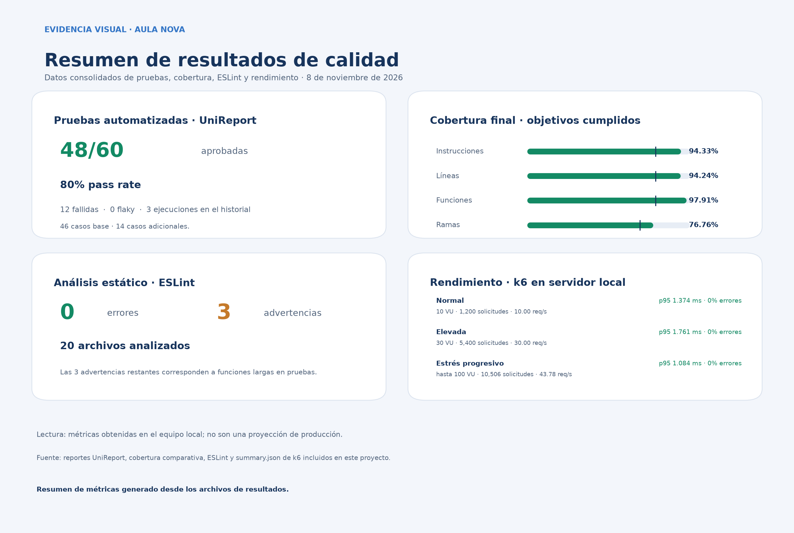

# Evidencias visuales — Aula Nova

La carpeta reúne capturas tomadas en VS Code Insiders y una lámina complementaria generada desde los reportes. Las capturas muestran los archivos de configuración y los artefactos de resultados guardados en el proyecto.

## Evidencias visuales

| N.º | Evidencia | Archivo |
|---:|---|---|
| 01 | Estructura de las áreas de calidad en el Explorador de VS Code | [01-estructura-proyecto.jpg](./01-estructura-proyecto.jpg) |
| 02 | Scripts configurados para pruebas, cobertura, lint, k6 y UniReport | [02-configuracion-paquetes.jpg](./02-configuracion-paquetes.jpg) |
| 03 | Reglas y alcance de ESLint | [03-configuracion-eslint.jpg](./03-configuracion-eslint.jpg) |
| 04 | Comparación de cobertura inicial y final | [04-cobertura-comparativa.jpg](./04-cobertura-comparativa.jpg) |
| 05 | Lámina resumen de métricas de calidad | [05-resumen-visual-reportes.png](./05-resumen-visual-reportes.png) |
| 06 | JUnit: pruebas unitarias, 24 pruebas y cero fallas | [06-pruebas-unitarias-junit.jpg](./06-pruebas-unitarias-junit.jpg) |
| 07 | JUnit: integración API, 12 pruebas y cero fallas | [07-pruebas-api-junit.jpg](./07-pruebas-api-junit.jpg) |
| 08 | JUnit: Playwright E2E, 10 pruebas y cero fallas | [08-pruebas-e2e-junit.jpg](./08-pruebas-e2e-junit.jpg) |
| 09 | Análisis comparativo de ESLint, cero errores y tres advertencias | [09-resultados-eslint.jpg](./09-resultados-eslint.jpg) |
| 10 | Métricas de rendimiento k6 por escenario | [10-rendimiento-k6.jpg](./10-rendimiento-k6.jpg) |

## Capturas de configuración de las herramientas

| Herramienta | Evidencia |
|---|---|
| Scripts y dependencias principales | [package.json](./02-configuracion-paquetes.jpg) |
| Jest y jsdom · pruebas unitarias | [jest.unit.config.cjs](./config-01-jest-unit.jpg) |
| Jest · pruebas de integración API | [jest.api.config.cjs](./config-02-api-jest.jpg) |
| Supertest · solicitudes de integración | [server.api.test.js](./config-03-supertest.jpg) |
| Playwright · servidor, Chromium y capturas | [playwright.config.cjs](./config-04-playwright.jpg) |
| Jest Coverage · umbrales de cobertura | [jest.config.cjs](./config-05-coverage.jpg) |
| k6 · endpoints y perfiles de carga | [aula.js](./config-06-k6.jpg) |
| UniReport · lectura de JUnit e historial | [unireport.cjs](./config-07-unireport.jpg) |
| ESLint · reglas y alcance | [eslint.config.cjs](./03-configuracion-eslint.jpg) |
Las capturas JUnit muestran los resultados por suite. El dashboard consolidado incluye además los casos adicionales y registra 60 pruebas: 48 aprobadas y 12 fallidas.

## Capturas de interfaz generadas por Playwright

La configuración guarda una captura PNG al finalizar cada escenario aprobado. Las diez imágenes proceden de la última ejecución completa de calidad y también están en `3. End-to-End (E2E) en navegador/reports/test-results/`.

| Escenario | Evidencia |
|---|---|
| E2E01 · Dashboard | [12-playwright-E2E01.png](./12-playwright-E2E01.png) |
| E2E02 · Perfil | [12-playwright-E2E02.png](./12-playwright-E2E02.png) |
| E2E03 · Cursos | [12-playwright-E2E03.png](./12-playwright-E2E03.png) |
| E2E04 · Calificaciones | [12-playwright-E2E04.png](./12-playwright-E2E04.png) |
| E2E05 · Bandeja de mensajes | [12-playwright-E2E05.png](./12-playwright-E2E05.png) |
| E2E06 · Diálogo de mensaje | [12-playwright-E2E06.png](./12-playwright-E2E06.png) |
| E2E07 · Envío válido | [12-playwright-E2E07.png](./12-playwright-E2E07.png) |
| E2E08 · Validación | [12-playwright-E2E08.png](./12-playwright-E2E08.png) |
| E2E09 · Navegación | [12-playwright-E2E09.png](./12-playwright-E2E09.png) |
| E2E10 · Recarga y mensajes | [12-playwright-E2E10.png](./12-playwright-E2E10.png) |
## Resumen visual de resultados

La siguiente lámina reúne las métricas de pruebas, cobertura, ESLint y k6. El [script generador](./generar_resumen_visual.py) permite actualizarla a partir de los reportes.

## Reportes verificables del proyecto

- [Dashboard consolidado UniReport](../7.%20Reportes%20y%20tendencias%20de%20pruebas/reports/unireport.html)
- [Historial de ejecuciones UniReport](../7.%20Reportes%20y%20tendencias%20de%20pruebas/reports/unireport-history.json)
- [Reporte HTML de cobertura](../4.%20Cobertura%20de%20c%C3%B3digo%20(JavaScript)/reports/coverage/index.html)
- [Resumen comparativo de cobertura](../4.%20Cobertura%20de%20c%C3%B3digo%20(JavaScript)/reports/analisis-comparativo.md)
- [Resultados de ESLint en JSON](../5.%20An%C3%A1lisis%20est%C3%A1tico%20(complejidad,%20code%20smells)/reports/eslint.json)
- [Análisis comparativo de ESLint](../5.%20An%C3%A1lisis%20est%C3%A1tico%20(complejidad,%20code%20smells)/reports/analisis-comparativo.md)
- [Resultados y análisis k6](../6.%20Rendimiento%20(tiempos%20de%20respuesta,%20throughput)/reports/k6/analisis-rendimiento.md)
- [Reporte HTML de Playwright](../3.%20End-to-End%20(E2E)%20en%20navegador/reports/playwright-html/index.html)

